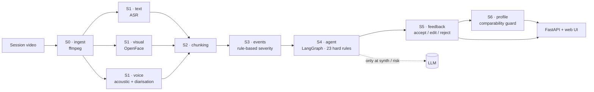

# PsyConAssist

**An auditable session-analysis assistant for psychological counseling.**

Most "AI therapist" demos optimise for sounding empathetic. PsyConAssist optimises for **not over-claiming**: every observation is tied to evidence in the session, severity is decided by rules rather than by a language model, and anything the model is allowed to say is constrained by an explicit rule set.

[中文说明](README.zh-CN.md)

---

## Why

A counseling assistant that invents a diagnosis, or infers "the client feels abandoned" from a pause, is worse than useless. Two properties matter more than fluency:

1. **Traceability** — every event points back to the transcript / frame / audio segment it came from.
2. **Restraint** — the system must be able to say "not enough evidence" instead of guessing.

PsyConAssist enforces both in the architecture: a rule engine owns severity and admissibility, an LLM is only reachable at two named nodes, and the feedback loop uses six fixed reason codes rather than free text.

> ⚠️ This is a research prototype. It is **not** a diagnostic device and must not be used as a substitute for clinical judgement.

## Pipeline

| Stage | Module | What it does |
| :-- | :-- | :-- |
| **S0** Ingest | `s0_ingest.py` | Normalise the session video, extract audio, detect the client's voice sample |
| **S1** Signals | `s1_text.py`, `s1_visual.py`, `s1_voice.py` | ASR transcript, facial action units (OpenFace), acoustic features + speaker separation |
| **S2** Chunking | `s2_chunk.py` | Segment the session into time-aligned chunks |
| **S3** Events | `s3_events.py` | Anomalous chunks → events with evidence; **severity from a rule table, not the LLM** |
| **S4** Agent | `s4_agent.py` | LangGraph state machine (12 nodes) with **23 hard rules**; the LLM is only allowed at `synth` and `risk` review |
| **S5** Feedback | `s5_feedback.py` | Clinician accept / edit / reject + one of six fixed reason codes; exemplars flow back |
| **S6** Profile | `s6_profile.py` | Cross-session client profile, with a comparability guard (`< 0.7` → no cross-session conclusion) |

## Architecture



Every heavy engine is optional. If `ffmpeg`, OpenFace, `pyannote` or Whisper are missing, the pipeline **degrades explicitly** and marks those signals as unavailable — it never silently fabricates them.

## Quickstart

```bash
git clone https://github.com/LuYuan-Zjyy/psycon-assist.git
cd psycon-assist
pip install -r requirements.txt

# run the whole pipeline on synthetic data — no video, no heavy models
python -m psyconassist.cli demo --subject P-0001 --duration 3000

# web UI
python -m psyconassist.webapp      # http://localhost:8000
```

Real session video (needs `ffmpeg` + the optional engines):

```bash
python -m psyconassist.cli run --video session.mp4 --subject P-0001 --client-sample 12.4 15.4
```

`--client-sample` is the time window that contains the client's voice only; it is used to build the speaker reference.

Create `.env` from `.env.example` and set `DS_API_KEY` (any OpenAI-compatible endpoint works — `LLM_BASE_URL` / `LLM_MODEL`).

## Design rules worth knowing

- **Severity is not a model output.** The rule table in `s3_events.py` decides `high / medium / low`; the LLM cannot upgrade or downgrade it.
- **The LLM has two doors.** Only `synth` and `risk` nodes may call a model; every other node is deterministic.
- **Deleting beats rewriting.** When a validation check fails, the sentence is dropped rather than regenerated (rule 16).
- **Feedback is structured.** Six reason codes, no free text, so the exemplar bank stays queryable.
- **Cross-session claims need comparability.** Below `0.7` comparability the system refuses to draw cross-session conclusions.

## Project layout

```
psyconassist/        pipeline stages (s0–s6), agent, config, FastAPI app
psyconassist/web/    static frontend (vanilla JS)
requirements.txt     runtime dependencies
pyproject.toml       packaging + console entry point
```

Data lives under `./data` by default (`PSY_DATA_ROOT` to override) and is git-ignored.

## Roadmap

- [ ] **Rule coverage tests**: one synthetic fixture per hard rule, asserting the rule actually fires.
- [ ] **English prompt set** for the two LLM nodes.
- [ ] **Event timeline UI**: scrub the session and see events aligned to the video.
- [ ] **Export report** (Markdown / PDF) for supervision sessions.
- [ ] **Adapter for a second ASR engine** to prove the signal layer is pluggable.

## Contributing

Issues and PRs welcome — see [CONTRIBUTING.md](CONTRIBUTING.md). Please never commit session data, transcripts, or API keys.

## License

[MIT](LICENSE) © 2026 LuYuan-Zjyy
