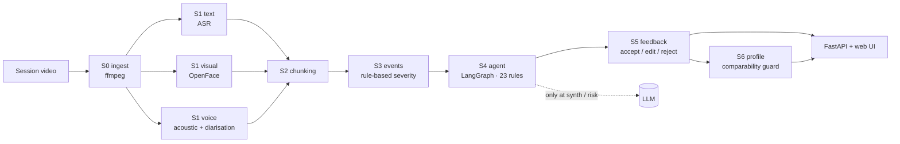

# PsyConAssist

**An auditable session-analysis assistant for psychological counseling.**

Most "AI therapist" demos optimise for sounding empathetic. PsyConAssist optimises for **not over-claiming**: every observation is tied to evidence, severity is decided by rules rather than by a language model, and the model is only reachable at two explicitly named nodes.

[中文说明](README.zh-CN.md) · [Pipeline & TODO](TODO.md)

[](LICENSE)
[](requirements.txt)
[](psyconassist/webapp.py)
[](CONTRIBUTING.md)

> ⚠️ Research prototype. **Not** a diagnostic device and not a substitute for clinical judgement.

---

## Why

A counseling assistant that invents a diagnosis, or infers "the client feels abandoned" from a pause, is worse than useless. Two properties matter more than fluency:

1. **Traceability** — every event points back to the transcript / frame / audio segment it came from.
2. **Restraint** — the system must be able to say "not available" instead of guessing.

PsyConAssist enforces both in the architecture: a rule engine owns severity and admissibility, the LLM is only reachable at two named nodes, and the feedback loop uses six fixed reason codes rather than free text.

## Design principles

| Principle | Meaning |
| :-- | :-- |
| Evidence-traceable | Every claim carries `evidence_ids`; time can be replayed back to the recording |
| Missing means "unavailable" | Failed modality writes `null` / `degrade` — never silently fills a zero |
| File-based stages | S0–S6 communicate through `data/<session_id>/`, no hidden in-memory hand-off |
| Limited LLM authority | LLM may only run at `synth` / `risk`; `severity` is decided by rules and cannot be changed |
| Comparability guard | `comparability < 0.7` → no cross-session conclusion |

## Pipeline

| Stage | Module | In → Out |
| :-- | :-- | :-- |
| **S0** Ingest | `stages/s0_ingest.py` | video → normalised `raw/norm.mp4` + `audio/16k.wav` |
| **S1** Signals | `stages/s1_text.py` · `s1_visual.py` · `s1_voice.py` | audio → transcript; video → AU table; audio → acoustic features, speaker roles |
| **S2** Chunking | `stages/s2_chunk.py` | signals → time-aligned `chunks/chunks.json` (VA per chunk) |
| **S3** Events | `stages/s3_events.py` | anomalous chunks → `events/events.json` + `events/evidence.json`; **severity from a rule table** |
| **S4** Agent | `stages/s4_agent.py` | events → `agent/claims.json`; LangGraph state machine with 23 hard rules |
| **S5** Feedback | `stages/s5_feedback.py` | claim + clinician action → `feedback/feedback.json`, exemplars |
| **S6** Profile | `stages/s6_profile.py` | sessions → `subjects/<id>/profile.json`, comparability-weighted |

Shared infrastructure lives in `core/`:

| Module | Responsibility |
| :-- | :-- |
| `core/paths.py` | `SessionPaths` / `SubjectPaths` — one place that knows the layout |
| `core/io.py` | atomic JSON read/write, optional reads |
| `core/errors.py` | `StageError` and friends |
| `core/logging_utils.py` | one logger factory |
| `core/models.py` | shared dataclasses / typed dicts |



## Quickstart

```bash
git clone https://github.com/LuYuan-Zjyy/psycon-assist.git
cd psycon-assist
pip install -r requirements.txt

# whole pipeline on synthetic data — no video, no heavy models
python -m psyconassist.cli demo --subject P-0001 --duration 3000

# web UI (binds 127.0.0.1:8100 and opens a browser)
python -m psyconassist.webapp
```

Real session video needs `ffmpeg` on PATH plus optional engines:

```bash
python -m psyconassist.cli run --video session.mp4 --subject P-0001 --client-sample 12.4 15.4
```

`--client-sample` is the time window containing the client's voice only; it builds the speaker reference. Missing engines degrade explicitly and are reported in `quality.json`.

Configuration comes from `.env` (see `.env.example`): `DS_API_KEY`, `LLM_BASE_URL`, `LLM_MODEL`, optional `PSY_DATA_ROOT`, `PSY_MAX_UPLOAD_MB`, `PSY_LANG` (ASR language, default `zh`), `PSY_ASR_MODEL` (default `small`), `OPENFACE_BIN`, `FFMPEG_BIN`.

## Security notes

- **Session / subject IDs are validated** before being used as path components — `../` cannot escape `data/`.
- **Uploads are capped** (`PSY_MAX_UPLOAD_MB`, default 2048) and restricted to a video-extension allowlist; oversized files are deleted immediately.
- **The web app binds to `127.0.0.1` only** and serves the frontend from `psyconassist/web`, never from `data/`.
- **No session content is logged**; logs carry IDs and stage names.
- Never commit `.env`, recordings, transcripts, or profiles — `data/` is git-ignored.

## Project layout

```
psyconassist/            package
  core/                  paths, io, errors, logging, models
  stages/                s0 … s6 (the pipeline)
  engine/                ffmpeg / OpenFace / pyannote / whisper wrappers
  web/                   static frontend
  cli.py, webapp.py      entry points
TODO.md                  pipeline walk-through + prioritised backlog
```

## Roadmap

See [TODO.md](TODO.md) for the prioritised backlog (rule fixtures, English prompts, timeline UI, report export, second ASR engine).

## Contributing

Issues and PRs welcome — read [CONTRIBUTING.md](CONTRIBUTING.md) first. Please never commit session data or API keys.

## License

[MIT](LICENSE) © 2026 LuYuan-Zjyy
