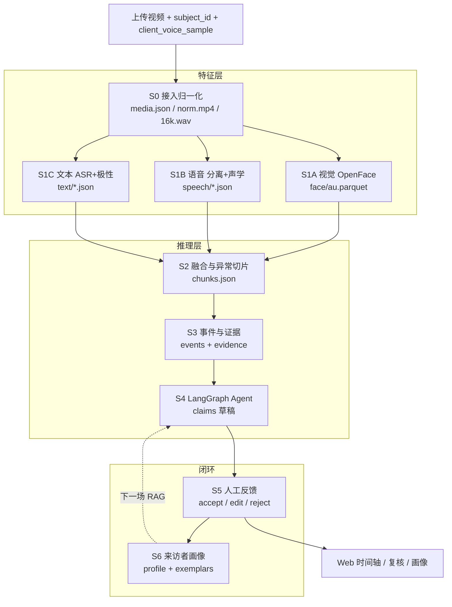

# PsyConAssist

> 心理咨询会谈多模态分析助手 · v0.2  
> 录像进 → 特征 → 异常事件 → Agent 草稿 → 人工复核 → 跨次画像

面向**咨询师侧**的辅助工具：把一场会谈录像拆成可回跳、可举证的观察草稿，而不是给出诊断。

| 原则 | 含义 |
|------|------|
| 证据可溯源 | 每条结论挂 `evidence_id`，时间可回跳到录像 |
| 缺失标「不可得」 | 模态失败写 `null` / `degrade`，**禁止静默填 0** |
| 阶段间只走文件 | S0–S6 通过 `data/<session_id>/` 落盘通信，不偷偷传大对象 |
| LLM 权限受限 | 仅进白名单节点；`severity` 由规则决定，不可改 |
| 跨次需可比性 | `comparability < 0.7` 不做跨次比较结论 |

**输入约定**

- 画面：来访者**单脸**（第二张脸忽略）
- 声音：咨询师 + 来访者双人
- 上传时必须提供来访者声音样本时间段 `[t0, t1]`（秒），用于说话人角色映射

---

## 目录

- [5 分钟跑通](#5-分钟跑通)
- [环境与配置](#环境与配置)
- [系统总览](#系统总览)
- [仓库结构](#仓库结构)
- [数据目录约定](#数据目录约定)
- [分阶段说明 S0–S6](#分阶段说明-s0s6)
- [CLI / Web / API](#cli--web--api)
- [降级与质量](#降级与质量)
- [硬规则摘要](#硬规则摘要)
- [协作与安全](#协作与安全github-必读)
- [PR 检查清单](#pr-检查清单)

---

## 5 分钟跑通

在仓库根目录（含 `.env` 的那一层，通常是 `xmh/`）执行：

```bash
# 1. 安装核心依赖
pip install -r psyconassist/requirements.txt

# 2. 配置密钥（无真实密钥勿提交）
cp .env.example .env
# 编辑 .env：至少可先留空密钥，用合成 demo 验证 S2–S6

# 3. 合成全流程（不需要 GPU / OpenFace / ffmpeg）
python -m psyconassist.cli demo --subject P-0001 --duration 300

# 4. 打开工作台
python -m psyconassist.webapp
# 浏览器 http://127.0.0.1:8100/
```

成功时终端会打印 JSON 摘要，例如：

```json
{
  "session_id": "S20261105-001",
  "subject_id": "P-0001",
  "s2": { "n_chunks": 4, "n_anomaly": 1, "baseline_available": true },
  "s3": { "n_events": 1, "by_type": { "low_activation": 1 } },
  "s4": { "n_claims": 4, "llm_ok": true },
  "s6": { "n_sessions": 1, "comparability": 0.0 }
}
```

产物落在 `data/<session_id>/` 与 `data/subjects/<subject_id>/`。

---

## 环境与配置

### 依赖分层

| 层级 | 内容 | 没有时 |
|------|------|--------|
| **必装 pip** | `numpy` `pandas` `pyarrow` `python-dotenv` `langgraph` `langchain-openai` …（见 `requirements.txt`） | 装不上就跑不了 |
| **S0 系统** | `ffmpeg` / `ffprobe`（建议进 PATH，或在 `.env` 写绝对路径） | 真实视频流水线 abort |
| **S1A 外部** | OpenFace `FeatureExtraction.exe` → `OPENFACE_BIN` | `degrade += visual` |
| **S1B 可选 pip** | `librosa` `soundfile` `pyannote.audio` + `HF_TOKEN` | 语音/分离降级 |
| **S1C 可选 pip** | `faster-whisper` `transformers` | ASR/极性降级 |
| **S4 可选** | `DS_API_KEY`（DeepSeek） | 规则模板 claims，`llm_ok=false` |

### `.env` 字段说明

从仓库根复制：

```bash
cp .env.example .env
```

| 变量 | 用途 | 必填？ |
|------|------|--------|
| `DS_API_KEY` | DeepSeek，S4 草稿合成 / 主题等 | 否（缺则模板兜底） |
| `LLM_BASE_URL` | 默认 `https://api.deepseek.com` | 否 |
| `LLM_MODEL` | 默认 `deepseek-chat` | 否 |
| `HF_TOKEN` | HuggingFace（pyannote 等） | 跑真实分离时建议有 |
| `HF_ENDPOINT` | 默认自动设 `https://hf-mirror.com` | 否 |
| `OPENFACE_BIN` | OpenFace 可执行文件绝对路径 | 否 |
| `FFMPEG_BIN` / `FFPROBE_BIN` | 找不到 PATH 时手写 | 否 |
| `PSY_DATA_ROOT` | 数据根，默认 `./data` | 否 |
| `PSY_LOG_LEVEL` | `INFO` / `DEBUG` | 否 |

> **切记**：`.env` 含密钥，已被 `.gitignore` 忽略；只提交 `.env.example`。

### 关键超参（`config.py`）

| 常量 | 默认 | 含义 |
|------|------|------|
| `GRID_SEC` | 30 | 融合网格窗长（秒） |
| `GRID_OVERLAP` | 0.15 | 网格重叠比例 |
| `CHUNK_MIN` / `CHUNK_MAX` | 4 / 45 | chunk 时长边界 |
| `MERGE_GAP` | 2 | 近邻异常段合并间隙（秒） |
| `BASELINE_WINDOW` | 8×60 | 本场基线取前 N 秒 |
| `COMPARABILITY_THRESHOLD` | 0.7 | 跨次比较门槛 |

---

## 系统总览



两种入口：

| 入口 | 调用 | 适用 |
|------|------|------|
| 真实视频 | `pipeline.run_full(video, client_sample, subject_id)` | 生产 / Web 上传 |
| 合成数据 | `pipeline.run_synthetic(subject_id, duration)` | 无重引擎时验证 S2–S6 |

编排入口：`pipeline.py`。Web：`python -m psyconassist.webapp`。CLI：`python -m psyconassist.cli`。

---

## 仓库结构

```
xmh/                          ← 仓库根（放 .env / .gitignore）
├── .env.example              ← 密钥模板（可提交）
├── .env                      ← 本地密钥（禁止提交）
├── .gitignore
├── start_web.bat             ← Windows 一键开 Web
├── data/                     ← 运行产物（禁止提交）
└── psyconassist/
    ├── README.md             ← 本文（唯一说明文档）
    ├── requirements.txt
    ├── config.py             ← 环境变量与超参
    ├── ids.py                ← session / claim / evidence ID
    ├── llm.py                ← DeepSeek 客户端
    ├── schemas.py            ← 时间轴等契约校验
    ├── synthetic.py          ← 合成特征（demo）
    ├── pipeline.py           ← S0→S6 编排
    ├── cli.py
    ├── webapp.py             ← FastAPI
    ├── web/                  ← 静态前端
    ├── core/                 ← 基础设施（改接口先看这里）
    │   ├── errors.py         ← StageError / EngineError / ContractError
    │   ├── models.py         ← TypedDict 契约真相源
    │   ├── paths.py          ← SessionPaths / SubjectPaths
    │   ├── io.py             ← 原子写 JSON / Parquet
    │   └── logging_utils.py
    ├── stages/               ← S0–S6 唯一实现
    │   ├── s0_ingest.py
    │   ├── s1_visual.py
    │   ├── s1_voice.py
    │   ├── s1_text.py
    │   ├── s2_chunk.py
    │   ├── s3_events.py
    │   ├── s4_agent.py       ← LangGraph 状态图
    │   ├── s5_feedback.py
    │   └── s6_profile.py
    └── engine/               ← 外部引擎薄封装
        ├── ffmpeg.py
        ├── openface.py
        ├── pyannote.py
        ├── acoustic.py
        ├── whisper.py
        └── sentiment.py
```

**导入约定（请统一）：**

```python
from psyconassist.stages import s2_chunk, s5_feedback
from psyconassist.core.paths import SessionPaths, SubjectPaths
from psyconassist.core.logging_utils import get_logger
from psyconassist.core.models import MediaInfo, StageReport
from psyconassist.core.errors import StageError

log = get_logger(__name__)
paths = SessionPaths(session_id)
# ✅ paths.voice_json
# ❌ wdir / "speech" / "voice.json"
```

改接口顺序：先改 `core/models.py` / `SessionPaths` → 再改读写阶段 → 最后改 `web/app.js`（若影响前端字段）。

---

## 数据目录约定

一场会谈：

```
data/<session_id>/
├── media.json              # S0 元数据（时长、采样段、路径）
├── quality.json            # 全场质量 + degrade 列表
├── raw/norm.mp4
├── audio/16k.wav
├── face/au.parquet         # 逐帧 AU / 头姿
├── speech/
│   ├── speaker.json        # 说话人段 + role
│   ├── voice.json          # 声学特征
│   └── vad.json
├── text/
│   ├── transcript.json     # 带 role 的转写
│   └── text_feat.json      # 极性 / 主题 / 风险词（含 t0/t1）
├── chunks/chunks.json      # S2 网格融合 + 异常标记
├── events/
│   ├── events.json         # 异常 → 事件
│   └── evidence.json       # 指标证据
├── agent/claims.json       # S4 待复核草稿
└── feedback/feedback.json  # S5 人工动作
```

来访者跨次：

```
data/subjects/<subject_id>/
├── profile.json            # 基线 / 场次列表 / comparability
└── exemplars/*.json        # edit 回流，供下一场 S4 RAG
```

`SessionPaths` / `SubjectPaths` 是上述路径的**唯一权威**；新增产物请先加属性再读写。

---

## 分阶段说明 S0–S6

### S0 · 接入与归一化 · `stages/s0_ingest`

| 项 | 内容 |
|----|------|
| 引擎 | ffmpeg / ffprobe |
| 硬条件 | **必须有音轨**；时长 &lt; 60s 仅标 `short_sample` |
| 产出 | `media.json`、`raw/norm.mp4`、`audio/16k.wav` |
| 失败 | 无 ffmpeg / 无音轨 → `StageError` abort |

`media.json` 关键字段：`session_id`、`duration`、`fps`、`width/height`、`has_audio`、`client_voice_sample`、`normalized_path`、`audio_path`。

---

### S1 · 三路特征

#### S1A 视觉 · `stages/s1_visual`

- OpenFace 提 AU 强度 + 头姿 → `face/au.parquet`
- 缺失写 **NaN**，不写 0
- 未配置 / 失败 → `degrade: ["visual"]`，`face_cov=0`，写空表结构

#### S1B 语音 · `stages/s1_voice`

1. 能量阈值 VAD  
2. pyannote 说话人分离（失败则单说话人兜底）  
3. 用 `client_voice_sample` 映射 `client` / `counselor`  
4. 按段提声学（F0、相对响度等）

产出：`speech/speaker.json`、`voice.json`、`vad.json`。

#### S1C 文本 · `stages/s1_text`

1. faster-whisper ASR（默认中文）  
2. 与说话人段对齐 → utterance（带 `role`）  
3. 情感极性（transformers，可降级）  
4. 风险词典扫描（宁可多报）  
5. 主题抽取（LLM，可选）

产出：`text/transcript.json`、`text_feat.json`（必须含 `t0/t1/role/text/polarity/topics/risk_hits`）。

每路 `run(...)` 返回 `StageReport`：`ok` / `degrade` / `reason` 及各阶段专有字段。

---

### S2 · 融合与异常切片 · `stages/s2_chunk`

- 默认 **30s 窗、15% 重叠** 网格，融合成逐格 VA（效价 / 唤醒）
- 相对**本场自身基线**做无监督异常检测  
- 异常类型：`risk` · `va_shift` · `silence` · `incongruence` · `low_activation`
- 产出连续覆盖 `[0, duration]` 的 `chunks.json`
- 契约：`schemas.check_covers` 校验时间覆盖

---

### S3 · 事件与证据 · `stages/s3_events`

- 每个异常 chunk → **一个 event**（一对一）
- 每个 event **≥ 1 条 evidence**（否则 `ContractError`）
- `severity` **只由规则表决定**，LLM 无权改：

| type | severity |
|------|----------|
| `va_shift` / `risk` | high |
| `silence` / `incongruence` | medium |
| `low_activation` | low |

产出：`events/events.json`、`events/evidence.json`。

---

### S4 · LangGraph Agent · `stages/s4_agent`

约 12 节点状态图（ingest → quality_gate → timeline → retriever → risk → **synth** → validator → policy → human / rewrite / strip）。

| 约束 | 说明 |
|------|------|
| LLM 白名单 | 主要进 **synth**（及风险复核）；其余节点规则/检索 |
| validator | 禁诊断词、禁动机推断；失败**删句不重写**（可有限 rewrite） |
| 落库 | `agent/claims.json`，`state=pending` |
| 无密钥 | 规则模板生成，`llm_ok=false` |

注入上下文：21 条 limits、按事件类型的变量说明、画像摘要、历史 exemplar（RAG）。

---

### S5 · 反馈闭环 · `stages/s5_feedback`

动作仅三选一：`accept` / `edit` / `reject`。

**reject 原因码六选一**（禁止自由文本冒充原因）：

| 码 | 含义 |
|----|------|
| `insufficient_evidence` | 证据不足 |
| `over_inference` | 从行为跳到心理 |
| `wording` | 措辞不专业 |
| `missing_info` | 漏了重要事件 |
| `time_misaligned` | 定位不对 |
| `other` | 其他 |

`edit` 必须带 `revised_text`，并写入 `subjects/<P>/exemplars/` 供下场 S4 使用。

---

### S6 · 来访者画像 · `stages/s6_profile`

- 每场结束更新 `profile.json`（**按 session 幂等**，重复跑不重复计数）
- 累积 VA 基线、场次列表、`exemplars_count`
- `comparability` 由质量（脸覆盖、ASR、分离）驱动；首场恒为 `0`
- **`comparability < 0.7` 不做跨次比较结论**

---

## CLI / Web / API

### CLI

```bash
# 合成 demo
python -m psyconassist.cli demo --subject P-0001 --duration 300 --seed 42

# 真实视频（client-sample = 来访者声音样本起止秒）
python -m psyconassist.cli run \
  --video path/to/session.mp4 \
  --subject P-0001 \
  --client-sample 12.4 15.4
```

### Web

```bash
python -m psyconassist.webapp
# 或 Windows: start_web.bat
```

前端能力：会话列表、时间轴/事件、草稿复核（反馈）、来访者画像、录像回放。

### 主要 API

| 方法 | 路径 | 说明 |
|------|------|------|
| `POST` | `/api/upload` | 上传视频 + `subject_id` + 声音样本，后台跑流水线 |
| `GET` | `/api/tasks/{task_id}` | 任务进度 / 错误 |
| `GET` | `/api/overview` | 会话与 subject 一览 |
| `GET` | `/api/sessions/{session_id}` | 一场完整产物聚合 |
| `GET` | `/api/subjects/{subject_id}` | 画像 |
| `POST` | `/api/sessions/{session_id}/feedback` | 提交 accept/edit/reject |
| `GET` | `/media/{session_id}/norm.mp4` | 归一化录像流 |

---

## 降级与质量

`quality.json` 示例：

```json
{
  "face_cov": 0.0,
  "asr_ok": true,
  "diarization_ok": true,
  "degrade": ["visual"]
}
```

| `degrade` | 典型原因 | 影响 |
|-----------|----------|------|
| `visual` | 无 OpenFace / 脸覆盖过低 | 无 AU；VA 更依赖文本/语音 |
| `voice` | 声学或分离失败 | 唤醒 / 角色对齐变弱 |
| `text` | ASR 失败 | 无转写 / 极性 / 风险事件 |

引擎缺失时：**继续跑通流水线**，缺失模态标不可得，不伪造观测值。

---

## 硬规则摘要

1. 缺失写 `null` / `NaN`，不填 0 冒充观测  
2. 画面只认来访者脸  
3. S1B 只做声学；转写归 S1C  
4. 说话人按 `client` / `counselor` 分角色  
5. 异常段 = 事件候选（一对一）  
6. 每个 event ≥ 1 evidence  
7. `severity` 只由规则决定  
8. LLM 仅进 synth（及风险复核白名单）  
9. validator 失败删句，不盲目重写  
10. 反馈原因码六选一  
11. `comparability < 0.7` 不做跨次比较结论  
12. Agent 优化走 Prompt + RAG，**不微调**

---

## 协作与安全（GitHub 必读）

### 绝对禁止提交

- `.env`、含真实 `API_KEY` / `TOKEN` / 密码的任何文件  
- SSH 私钥：`*.pem` `id_rsa*` `*.ppk`  
- 服务器账号、隧道脚本里的主机/口令  
- `data/`（录像与分析结果）  
- `__pycache__/`、`*.tgz` 部署包  

仓库根 `.gitignore` 已覆盖上述路径。推送前请自检：

```bash
git status
# 确认没有 .env / data / *.pem / 隧道脚本
```

### 队友分工建议

| 模块 | 建议负责人关注点 |
|------|------------------|
| `engine/*` | 二进制与 HF 模型可用性、超时与降级 |
| `stages/s0–s1` | 特征契约字段完整（尤其 `t0/t1`） |
| `stages/s2–s3` | 异常检出稳定性、evidence 完整性 |
| `stages/s4` | limits / validator / LLM JSON 约束 |
| `stages/s5–s6` | 反馈码、幂等画像、exemplar 回流 |
| `web*` | API 字段与 `web/app.js` 同步 |

### 日志

```bash
# Windows PowerShell
$env:PSY_LOG_LEVEL="DEBUG"
python -m psyconassist.cli demo --subject P-0001 --duration 120
```

统一使用 `get_logger(__name__)`；关键路径打 `session_id` + 计数，禁止裸 `except: pass`。

---

## PR 检查清单

- [ ] 是否先更新了 `core/models.py` 和/或 `SessionPaths`？  
- [ ] 新路径是否走 `SessionPaths` / `SubjectPaths`，无手写相对路径？  
- [ ] 缺失模态是否写 `null` 并进入 `degrade` + `reason`？  
- [ ] 异常是否用 `StageError` / `EngineError` / `ContractError`？  
- [ ] `python -m psyconassist.cli demo --duration 120` 是否跑通？  
- [ ] 若改了 API 字段，是否同步 `web/app.js`？  
- [ ] `git status` 无 `.env` / `data/` / 密钥 / `__pycache__`？  

---

有问题先看本 README → 再看对应 `stages/*.py` 模块头注释 → 最后查 `core/models.py` 契约。欢迎在 PR 描述里写清：**改了哪一阶段、降级行为是什么、如何本地验证。**
