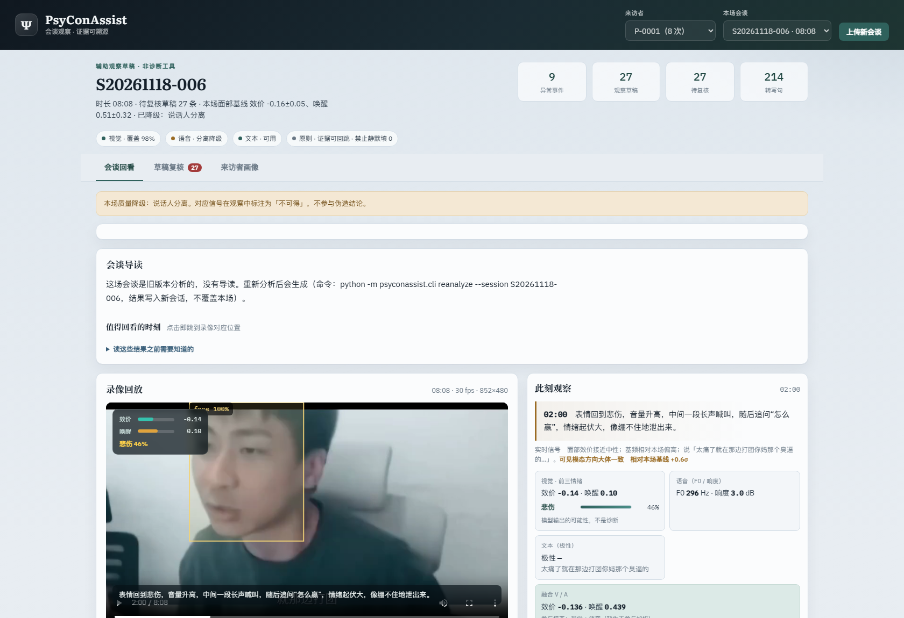
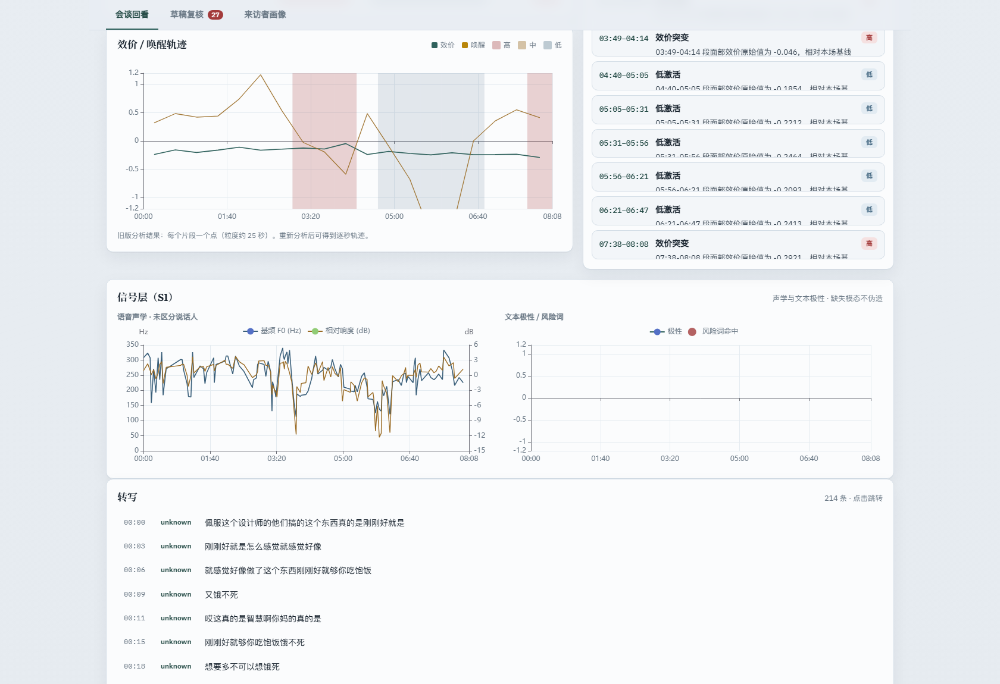
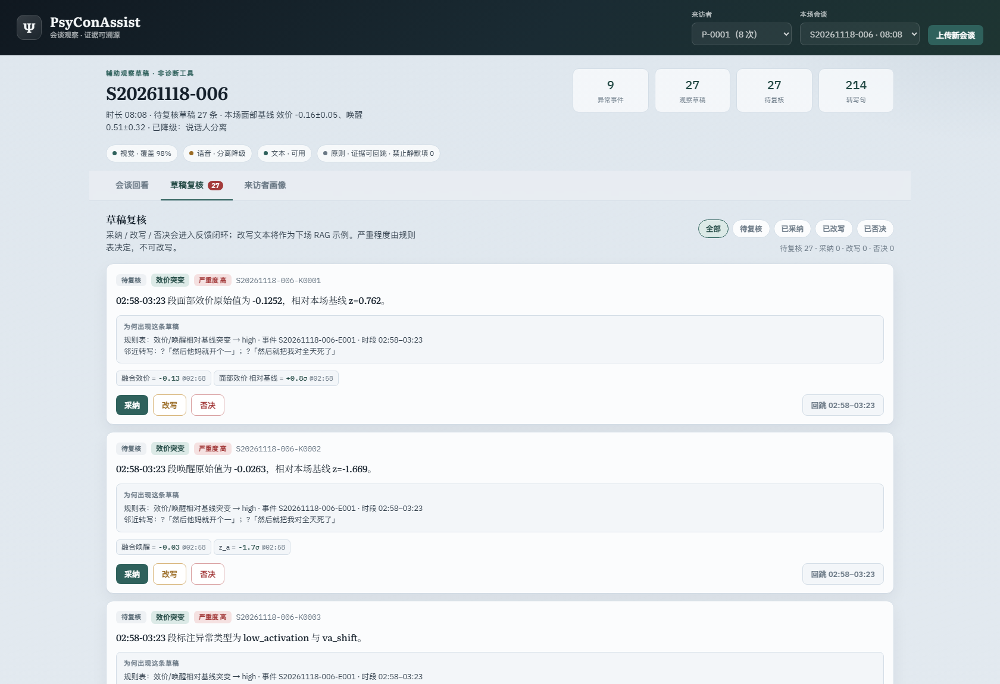
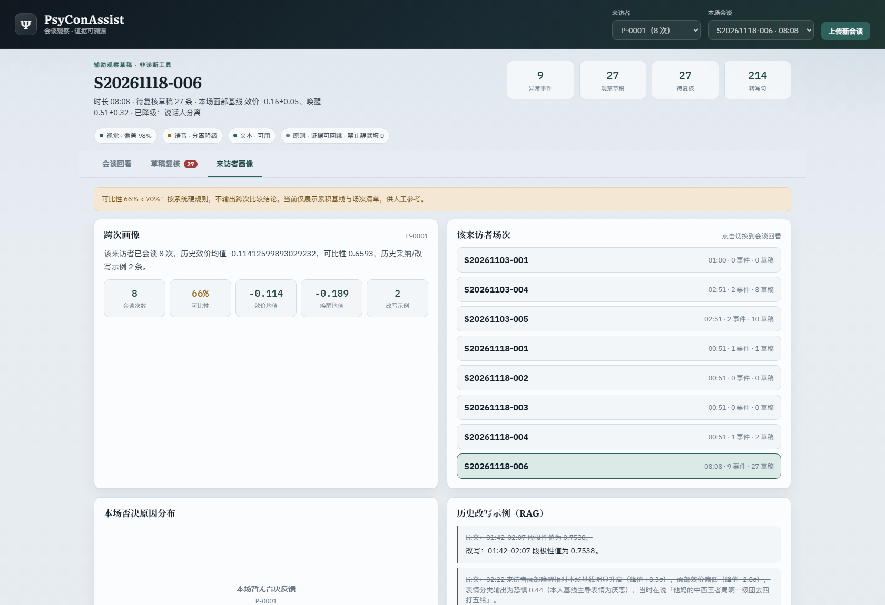
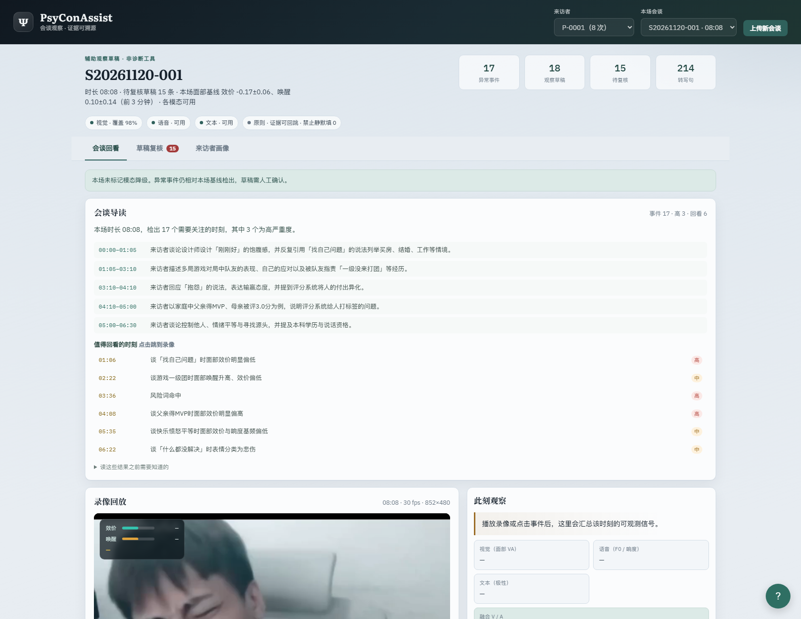

# PsyConAssist 现状说明

> **一句话**：把一段会谈录像，变成一份可回看、可解释、可复核的证据工作台。
>
> 定位是**镜子，不是顾问**：只呈现"看到了什么、凭什么这么说"，不下诊断；每条结论都能点回原片；缺失的信号标「不可得」，绝不用零填充。

---

## 一、它现在能做什么

输入一段会谈视频，系统会输出下面这一整套东西：

| 层面 | 输出 |
| --- | --- |
| **人脸** | 每帧的人脸位置；每帧的效价 / 唤醒；八类表情的完整分布 + 模糊度（熵） |
| **语音** | 逐句转写；每 25–30 秒的基频（F0）与相对响度 |
| **文本** | 逐句极性、风险词命中 |
| **时间结构** | 按 25–30 秒切片；从中检出事件（效价突变 / 低激活 / 沉默 / 言行不一致） |
| **参照系** | 每个来访者的本场个体基线（前 8 分钟统计），用来定义"什么算异常" |
| **解释层** | 每段一句自然语言观察笔记（大模型写），以及每条结论的证据编号 |
| **跨场次** | 来访者画像：历史基线、可比性判断、既往改写样例 |
| **人工闭环** | 草稿可采纳 / 改写 / 否决，反馈进入下一场 |

---

## 二、界面

### 2.1 会谈回看：一条时间轴串起所有信号

左边是录像，叠加了**人脸框**和**实时仪表**（效价、唤醒、当前表情），底部是当前片段的观察笔记字幕；右边是「此刻观察」，一句话解释当前状态，下面跟一行**证据**（相对基线偏离多少、基频多少、说了什么），再往下是视觉 / 语音 / 文本三张信号卡和融合结果。

这里有一个关键设计：**上面是人话，下面是数字**。读者先看懂发生了什么，再决定要不要核对数字。

### 2.2 事件与信号层：把"哪里值得看"标出来

- 效价/唤醒曲线，红色底色是检出的异常段；
- 右侧事件列表，每条带时间、类型、严重度和回跳按钮；
- 下面是语音声学（基频、响度）和文本极性两路原始信号；
- 最下面是逐句转写，点击任意一句可跳到对应时刻。

### 2.3 草稿复核：结论必须能被推翻

每条观察草稿都包含：

- 严重程度（由规则决定，不由模型决定）；
- 草稿原文；
- **「为何出现这条草稿」**：触发的规则、对应事件、邻近的转写原话；
- 证据编号（可回跳）；
- 三个动作：**采纳 / 改写 / 否决**。

改写会作为下一场的参考样例，否决会要求填原因——这样系统才知道自己哪里说错了。

### 2.4 来访者画像：先判断"能不能比"，再比较

画像页有一道硬门槛：**可比性低于 70% 时，系统明确拒绝输出跨次结论**，只展示累积基线和场次清单供人工参考。

下面还有本场的否决原因分布、以及历史改写示例——这些反馈会反过来影响下一场的措辞。

---

## 三、技术构成（能力级）

不深入实现，只说每一块现在**能做到什么**：

| 模块 | 能力 |
| --- | --- |
| **视觉** | 在服务器上稳定检测人脸（多张脸时取最可信的一张），逐帧回归效价/唤醒，并输出八类表情的概率分布与模糊度 |
| **语音** | 自动转写（无需人工），并按窗口提取基频与响度，用于判断语气的高低、强弱 |
| **文本** | 对转写逐句打极性，并命中风险词 |
| **融合** | 按各模态的可信度加权融合；**缺失的模态不参与加权，不补零** |
| **异常判定** | 以"个体基线"为参照算偏离程度（z 分数），再由规则决定严重度；大模型不参与判定 |
| **解释生成** | 大模型把"表情 + 语气 + 原话"揉成一句观察笔记，只负责措辞 |
| **前端** | 单页应用；视频、图表、事件、转写四者联动，点哪跳哪 |
| **部署** | 单机服务 + 静态前端；可挂临时隧道对外访问 |
| **联邦设计** | 只交换"个体基线 4 个数 + 个性化适配器 6 个数"，原始音视频不出本机（机制原型，尚未做真实多机构实验） |

---

## 四、数据现状

库中共 **13 个会话**，其中 3 个是真实视频跑出来的：

| 素材 | 时长 | 结果 |
| --- | --- | --- |
| 英文访谈 | 950 秒 | 人脸覆盖 97.8% |
| 短视频 | 51 秒 | 暴露了"最后一帧被误判为事件"的问题 |
| 中文视频（B 站） | 489 秒 | 2445 帧人脸（覆盖 98%）、214 句转写、19 个切片、9 个事件、27 条草稿、18 条观察笔记 |

---

## 五、怎么打开

| 入口 | 说明 |
| --- | --- |
| **公网** | 带账号密码的临时 https 地址，适合发给外部的人看 |
| **本机隧道** | 本机浏览器直连服务器，无需密码 |
| **局域网** | 同一网段的人可直接访问 |

---

## 六、现在明确做不到的

1. **说话人分离是降级状态**——目前只能当单说话人处理，双人会谈撑不住。
2. **没有 AU（面部动作单元）**——"哭还是笑"仍靠表情分类间接判断。
3. **文本极性这一路不稳定**——部分会话里极性全为空，导致极性曲线是一条平的零线。
4. **事件切得碎**——一次持续的情绪会被拆成好几段分别上报，缺少时长约束。
5. **流水线自带的那部分草稿仍是模板腔**（如"效价原始值为 −0.24"），没跟上大模型笔记的质量。
6. **联邦学习只有机制原型**——没有真实多机构数据验证。
7. **公网访问是临时的**——隧道重启会换地址。

---

## 七、代码与研究资产

- GitHub 上两份提案：个体基线 + 视频可视化 + 联邦原型；以及"人脸特征不能只有效价/唤醒"的表情扩展。
- 一份联邦学习设计说明：明确交换物、隐私边界与接入点，并如实记录"合成数据上联邦尚未体现收益"。

---

## 八、会谈导读：打开一场会谈先看什么

时间轴最上方是一张导读卡片，回答"这场谈了什么、从哪里看起"：

- **全场概览**：2–3 句话按时间顺序概括谈话内容；
- **话题分段**：切成 3–6 段，每段带起止时间，点击直接跳到录像；
- **值得回看的时刻**：最多 6 条，标题是"现象 + 当时的话题"（如"谈「找自己问题」时面部效价明显偏低"），带严重度标记，点击跳转；
- **读这些结果之前需要知道的**：基线取多长、表情分类在什么情况下会错、文本极性对反讽不敏感等。

设计上刻意分工：**导读只复述"谈了什么"，不写效价/唤醒/表情**；测量与异常交给事件。这样两处不会互相矛盾。风险事件和高严重度事件强制出现在导读里，LLM 漏掉由规则补齐。

## 九、咨询助手与心理学知识库

**知识库**：65 条，按 14 类组织——伦理（保密及例外、知情同意、双重关系、胜任力与转介）、咨询技术（反映、澄清、共情性猜测、面质、此时此地、结束）、主要流派（人本、精神动力、CBT、DBT、ACT）、情绪与依恋、风险评估（询问方式、评估维度、保护因素、安全计划）、会谈结构、创伤知情、观察原则、常见误判。

每条都有编号（如 `RS-01` 自杀风险的询问）、来源标注与用途；助手回答时引用编号，可追溯。

**咨询助手**（右下角问号）：通晓本场会谈的转写、指标、事件、草稿与基线，用 ReAct 循环先查知识库、再取原话与指标，最后给出状态判断、疏导方向与草稿修改建议。

**人工观察**：咨询师可以自己写一条观察（时间窗 + 内容），进入同一套采纳/改写/否决闭环。

**反馈再审视**：改写或否决后自动触发一次再审视，输出"判定 / 原因 / 建议 / 是否需重查基线 / 是否需更新对人的理解"，以卡片显示在草稿列表顶部。是否采纳仍由咨询师决定。

> 边界：知识库目前是**基于通用心理学框架整理的种子库**，不是某几本书的原文；若要严格对应教材，需要导入具体书目并由专业人员校对。
